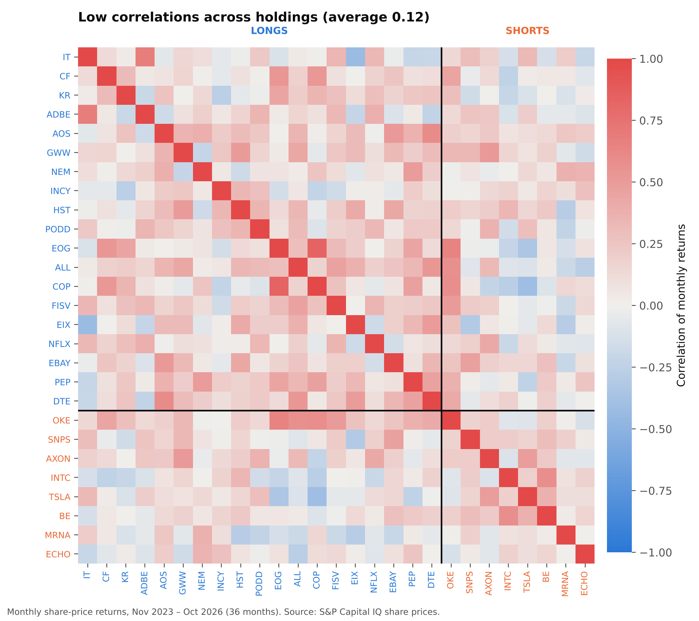
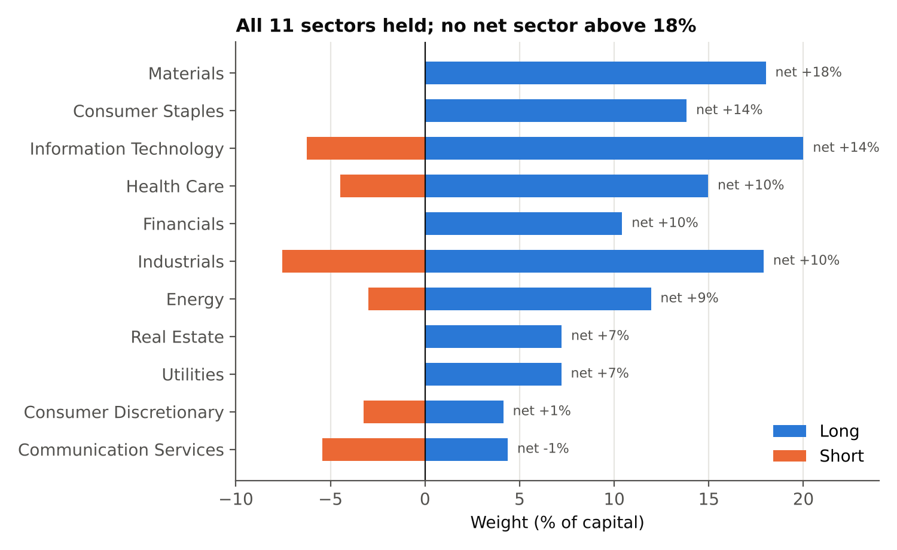

# Quality 130/30 Fund

**EC4430 Portfolio Management** – an alpha-based, bottom-up long/short equity fund that buys high-quality US stocks and short-sells low-quality ("junk") stocks.

| | |
|---|---|
| **Strategy** | 130/30 quality long/short (Asness, Frazzini & Pedersen, 2013) |
| **Universe** | S&P 500 constituents |
| **Portfolio** | 27 stocks: 19 long (130%), 8 short (−30%), net exposure 100% |
| **Horizon** | 12 months, buy-and-hold |
| **Benchmark** | S&P 500 |

## Key results

| Diversification measure | Result |
|---|---|
| Effective number of stocks (1/HHI) | 23 |
| Largest single position | 10% |
| Sectors covered | 11 of 11 |
| Average correlation, all 27 holdings | **0.12** |
| Average correlation, long vs short | **0.07** |
| Portfolio beta vs S&P 500 (3y monthly) | 0.07 |






   - *Payout*: (dividends + buybacks − issuance) / net income
2. **Selection** – longs from the top 20% in each sector, filtered for valuation (forward P/E ≤ 1.5× sector median), ROE ≥ 10%, debt/assets ≤ 0.5, beta ≤ 1.3 and no airlines; shorts from the bottom 20%, priced above the sector median P/E. Max 2 stocks per sector per side.
3. **Weights** – proportional to quality score; caps of 10% per long and 6% per short.
4. **Diversification tests** – concentration metrics, sector spread, and the correlation matrix of 36 months of returns.

## How to run

**Easiest:** open `notebook/Quality_130_30_Fund.ipynb` – it walks through every step with the charts.

**From the command line:**
```bash
pip install -r requirements.txt
python src/build_portfolio.py     # quality scores + 27-stock portfolio -> output/portfolio.csv
python src/diversification.py     # concentration metrics + charts 1–3
python src/correlation.py         # correlations, betas, historical risk + charts 4–5
python src/report_figures.py      # report figures: charts 6–8
```
Run the commands from the repository root.

**Google Colab:** upload the whole folder (or `git clone` this repository), then run the notebook.

## Repository structure
```
data/       S&P Capital IQ exports (S&P 500 screen, 7 Nov 2026; daily prices Oct 2023 – Oct 2026)
src/        build_portfolio.py, diversification.py, correlation.py, style.py
notebook/   Quality_130_30_Fund.ipynb (step-by-step walkthrough with outputs)
output/     portfolio.csv, quality scores, metrics tables and charts
```

## Limitations
- The historical check applies today's weights to past returns, so it has **look-ahead bias** and is not a performance backtest.
- Several shorts rallied sharply over 2024–26 (e.g. Bloom Energy), illustrating **short-squeeze risk**.
- Prices are share-price returns (dividends excluded); Capital IQ supplies 3-year rather than 5-year betas.

## References
- Asness, Frazzini & Pedersen (2019). Quality Minus Junk. *Review of Accounting Studies*, 24, 34–112.
- Evans & Archer (1968). Diversification and the Reduction of Dispersion. *Journal of Finance*, 23(5).
- Statman (1987). How Many Stocks Make a Diversified Portfolio? *JFQA*, 22(3).
- Campbell, Lettau, Malkiel & Xu (2001). Have Individual Stocks Become More Volatile? *Journal of Finance*, 56(1).
- Cohen, Polk & Silli (2010). Best Ideas. Working paper.

*Data: S&P Capital IQ Pro, accessed through university licence. For academic use only.*
